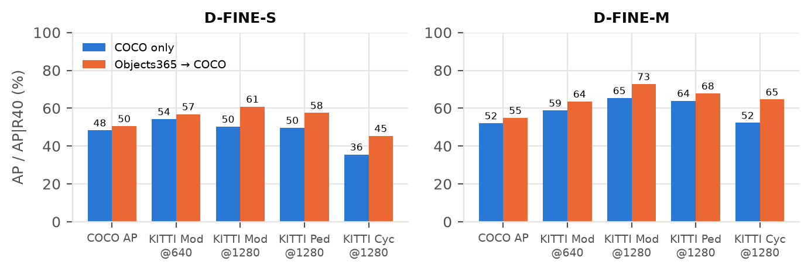
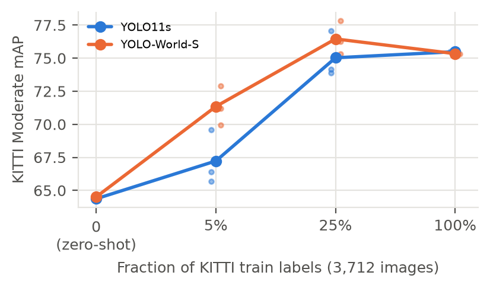

<div class="abstract">

The main report found that the two open-vocabulary detectors, YOLO-World-L and Grounding DINO-T, were the best zero-shot KITTI
detectors although they ranked only sixth and third on COCO. This extension asks *why*, and whether the advantage survives
fine-tuning, under the same protocol, mapping and metric code. **(A)** A matched-architecture test: D-FINE-S/M trained on COCO only
versus the same networks pre-trained on Objects365 first. Objects365 pre-training adds 2.2–2.8 COCO AP but 7.4–10.6 KITTI Moderate
mAP at 1280 px. D-FINE-M (Objects365) reaches **72.7** Moderate mAP, the best zero-shot result in either study — from a *closed-set*
detector. Broader pre-training data, not an open vocabulary, is the more likely cause of the earlier result. The newer YOLO26 adds
1.7–1.8 COCO AP over YOLO11 but only 0.4–0.8 KITTI mAP at 1280 px. **(B)** Label-budget fine-tuning at 1280 px with three seeds:
the open-vocabulary YOLO-World-S beats the closed-set YOLO11s at 5% of KITTI labels (71.3 ± 1.5 vs. 67.2 ± 2.1 Moderate mAP;
Welch p = 0.054), the gap closes at 25% (76.5 ± 1.3 vs. 75.0 ± 1.8) and disappears at 100% (75.3 vs. 75.5). The seed spread
(up to 3.9 mAP and 10.4 Cyclist AP at a fixed subset) is large enough that the main report's single-seed "77.0 with a quarter of the labels" was a
favourable seed: with three seeds, 25% of the labels matches but does not beat the full set.

</div>

# 1. Questions and design

The main report left two open questions. Its open-vocabulary detectors transferred to KITTI best, but they differ from the closed-set
models in two ways at once: an open, text-conditioned classifier, and much broader pre-training data (Objects365, GoldG, CC3M and
others [4, 5]). And the main report's fine-tuning used a single seed per configuration, so small differences (77.0 with 25% of the
labels vs. 75.5 with all of them) could not be separated from training noise. Four questions follow:

* **Q1 (data).** With the architecture held fixed, how much of the zero-shot KITTI gain comes from broader pre-training data alone?
* **Q2 (generation).** Does the newest real-time CNN, YOLO26 [3], transfer better than YOLO11 at matched size?
* **Q3 (prompts at small scale).** Does the main report's prompt finding — COCO names plus a geometric mapping beat KITTI's own class
  names — hold for the small YOLO-World-S?
* **Q4 (labels).** When KITTI labels are scarce, does open-vocabulary pre-training give a better starting point than closed-set COCO
  pre-training, and how much do seeds matter?

For Q1, D-FINE [1] is a good probe because its authors release identical S and M networks in two versions: trained on COCO only, and
pre-trained on Objects365 [2] (365 classes, ~1.7 M images) then fine-tuned on COCO. Both versions output the same 80 COCO classes, so
the COCO→KITTI mapping is identical; only the pre-training data differs.

# 2. Setup

Everything not stated here is unchanged from the main report (Sec. 3): same RTX 5060 Laptop GPU (8 GB, 45 W), PyTorch 2.11 + CUDA 12.8,
Ultralytics 8.4.197, Transformers 5.22.1. KITTI [8] val is the Chen et al. split (3,769 images), scored with the same devkit-style AP|R40 at
Easy / Moderate / Hard. All runs use score threshold 0.001, 300 raw detections and the 100-detection cap after mapping, batch 1, FP32.
COCO-vocabulary models use the default **strict fused** Cyclist rule.

* **D-FINE-S/M** (Hugging Face [10] `ustc-community/dfine-{small,medium}-{coco,obj2coco}`): the native processor *stretches* every image to
  a square (640² or 1280²), like RT-DETR in the main report, and takes the top-300 query × class scores (no NMS).
* **YOLO26s/m** (`yolo26{s,m}.pt`): letterbox, long side 640 or 1280, default one-to-many head with our multi-label NMS (IoU 0.7). This
  is the setting of the published "standard" accuracy column, not the optional NMS-free head.
* **YOLO-World-S v2** (`yolov8s-worldv2.pt`): COCO-80 prompts plus mapping, or KITTI's seven class names as prompts.
* **Fine-tuning (Q4):** YOLO11s and YOLO-World-S from their COCO/open-vocabulary checkpoints, 1280 px, 20 epochs, batch 4, Ultralytics
  defaults, on 5% (186 images), 25% (928) or 100% (3,712) of KITTI train. Seeds 0/1/2 at 5% and 25%, one seed at 100%. The last
  checkpoint is evaluated once on KITTI val, which is never used for model selection. Ultralytics' `fraction` takes the *first* N
  images in file order, so the three seeds share one subset and measure **training noise only** (initialisation order, augmentation,
  data order), not subset sampling.

```bash
bash scripts/run_extension.sh                     # all runs below (~6.5 h on this GPU), logged to logs/command_log.txt
uv run python scripts/run_inference.py --model dfine_m_o365 --dataset kitti --imgsz 1280
uv run python scripts/finetune_yolo.py --model yolov8s-worldv2.pt --imgsz 1280 --epochs 20 --batch 4 --fraction 0.05 --seed 1
uv run python scripts/evaluate.py && uv run python scripts/summarize_extension.py && bash report/build.sh extension
```

All new models reproduce their published COCO val2017 [9] AP closely: D-FINE-S/M 48.3 / 52.0 (published 48.5 / 52.3), Objects365 versions
50.5 / 54.9 (50.7 / 55.1) [1]; YOLO26s/m 47.9 / 52.7 (48.6 / 53.1) [3]; YOLO-World-S v2 37.0 (37.7) [6].

# 3. Results A: zero-shot transfer

<div class="tcap">Table 1. COCO val2017 (in-domain) and KITTI val zero-shot (AP|R40, %). Car / Ped / Cyc and Hard are at 1280 px. D-FINE
inputs are stretched squares; YOLO inputs are letterboxed.</div>

<!--TABLE:ext_zeroshot-->

<figure><figcaption>Figure 1. Matched-architecture test: D-FINE trained
on COCO only vs. pre-trained on Objects365 and then fine-tuned on COCO. The same networks and the same 80 output classes; only the
pre-training data differs.</figcaption></figure>

## 3.1 Q1 — pre-training data, with architecture fixed

Objects365 pre-training is worth **2.2 (S) and 2.8 (M) COCO AP** but **10.6 and 7.4 KITTI Moderate mAP at 1280 px** (2.6 and
4.8 at 640 px). At 1280 px the gain is 2.5–5 times larger out of domain than in domain. All three classes gain: Cyclist,
the class the main report found COCO weakest on, rises 9.8 (S) and 12.3 (M) points and Pedestrian 7.9 and 3.9. Car rises 14.1 for S —
its largest gain, from a low COCO-only starting point (65.6) — but only 5.9 for M, for which Cyclist gains most. Small objects benefit in-domain as well (COCO APs +3.7 / +4.5).

With Objects365, the closed-set **D-FINE-M reaches 72.7 Moderate mAP**, above YOLO-World-L (70.9) and Grounding DINO-T (70.5) from
the main report, with the same COCO-80 output and mapping as every closed-set model. An open vocabulary is therefore **not necessary**
for the best zero-shot KITTI accuracy; broad detection pre-training data is enough. This does not prove the vocabulary contributes
nothing (we have no open-vocabulary model trained on COCO only), but it removes the need to invoke it. The main report's ranking
(open-vocabulary models first) is better read as a ranking by pre-training data.

One D-FINE cell does not follow the trend: COCO-only **D-FINE-S drops from 54.2 to 50.2** when the input grows from 640² to 1280²,
while every other D-FINE and YOLO model gains. A 1280² stretch magnifies KITTI's 375-px-tall frames 3.4× vertically, far from the
640² training distribution. The small COCO-only model, with the narrowest pre-training, is the one that fails to cope; with
Objects365 pre-training the same network gains 4.0 points.

## 3.2 Q2 — YOLO26 vs. YOLO11

YOLO26 improves COCO AP over YOLO11 by **1.8 (s) and 1.7 (m)** and KITTI at 640 px by 1.6 and 2.6, but at 1280 px the gap shrinks to
**0.4 and 0.8** Moderate mAP — smaller than the spread between fine-tuning seeds in Sec. 4 (inference itself is deterministic). Per class, Car, Pedestrian and Cyclist all move by
under 2 points. Same pre-training data, same transfer: the newer generation's in-domain gains carry over to KITTI only weakly once
input resolution, the main report's largest zero-shot lever, is fixed. YOLO26m at 1280 px (66.0) is still 6.7 points below
D-FINE-M (Objects365).

## 3.3 Q3 — prompts for the small open-vocabulary model

<div class="tcap">Table 2. YOLO-World v2 at 1280 px on KITTI: COCO-80 prompts plus geometric mapping vs. KITTI's seven class names.
YOLO-World-L rows are from the main report.</div>

<!--TABLE:ext_yoloworld_vocab-->

The main report's finding holds at small scale but weakens: KITTI-name prompts cost YOLO-World-S **15.9** Moderate mAP (24.5 for
YOLO-World-L), and Cyclist AP halves (48.6 → 23.8). With KITTI names, S and L are close (48.6 vs. 46.4), so the larger model's extra
capacity goes almost entirely into the COCO-name path. Zero-shot YOLO-World-S with COCO names (64.5) equals YOLO11s at the same
resolution (64.4) despite 9.1 points lower COCO AP — the same "broader data transfers better" pattern as Q1, at small scale.

# 4. Results B: label budgets with three seeds

<div class="tcap">Table 3. KITTI val Moderate AP|R40 after fine-tuning at 1280 px for 20 epochs. Mean ± sample standard deviation over
seeds 0/1/2 (same image subset); 100% is one seed. Zero-shot rows use COCO names + strict fused mapping; fine-tuned rows predict KITTI
classes directly.</div>

<!--TABLE:ext_budget-->

<figure><figcaption>Figure 2. Label-budget curves. Large markers: seed
means; small markers: individual seeds.</figcaption></figure>

**Open-vocabulary pre-training helps most when labels are scarce.** With 186 labelled images, YOLO-World-S reaches 71.3 ± 1.5 and
YOLO11s 67.2 ± 2.1 Moderate mAP; every YOLO-World-S seed (70.0–72.9) beats every YOLO11s seed (65.7–69.6), though with three seeds per
arm the difference is only marginally significant (Welch t = 2.8, p = 0.054). The gap comes from the vulnerable classes. With 5% of the
labels, YOLO11s is *below its own zero-shot score* on Pedestrian (68.4 vs. 69.0) and Cyclist (42.5 vs. 46.9): the few examples
overwrite the COCO `person` features faster than they teach KITTI's conventions. YOLO-World-S gains on both (72.5, 49.7) with a
quarter of the Pedestrian standard deviation (0.7 vs. 2.9). At 25% the gap is 1.4 mAP (p = 0.32), and with all labels the two models are
equal (75.3 vs. 75.5). Car is saturated by 5% for both (≈ 91–92).

**A quarter of the labels matches the full set but does not beat it.** The main report's single-seed result, 77.0 with 25% vs. 75.5
with 100%, was the best of three YOLO11s seeds (77.0, 74.2, 73.9; mean 75.0 ± 1.8). With three seeds, 25% and 100% are
indistinguishable for both models. The practical conclusion stands — on KITTI, ~900 labelled frames at 1280 px give essentially
full-data accuracy in 0.3 h of training instead of 1.24 h — but the "fewer labels is better" reading does not.

**Seed noise is large and class-dependent.** Moderate mAP spans up to 3.9 points across seeds at a fixed subset, and Cyclist AP up to
10.4 points (YOLO11s at 25%: 66.9 / 57.1 / 56.5, sd 5.9), while the Car standard deviation is at most 0.3. Single-seed fine-tuning comparisons on KITTI's rare classes
should therefore be read with a ±3–6-point Cyclist margin; the main report's 100%-data rows (one seed each) carry this caveat too.

**Cost.** Training memory is 4.1–4.3 GB for YOLO-World-S and 4.6 GB for YOLO11s at batch 4; time scales with the data (≈ 0.09 h at
5%, 0.3–0.38 h at 25%, 1.24 h at 100% for either model).

# 5. Speed of the new models

<div class="tcap">Table 4. KITTI frames, batch 1, mean and median (p50) over 100 images after one full warm-up pass; full `predict()` including pre- and
post-processing. Same harness as the main report's Table 6.</div>

<!--TABLE:ext_speed-->

YOLO26 runs at 18–25 ms per frame — the same Python-bound floor as YOLO11 in the main report — and FP16 helps only at 1280 px. D-FINE
is slower: 27 / 34 ms for S / M at 640², and 77 ms for D-FINE-M at 1280² (timed with the COCO weights; the Objects365 network is identical), where its 72.7 Moderate mAP costs about three times the
latency of YOLO26m (66.0 at 25 ms). FP16 makes D-FINE *slower* at 640² (31 vs. 27 ms for S) through the Hugging Face pipeline's dtype
casts, and gives 1.13× (mean; 1.15× median) at 1280². YOLO-World-S gains the most from FP16 (23.4 → 17.8 ms mean). An exported TensorRT engine would change
all of these numbers; see Sec. 7.

# 6. Limitations

* **One subset per budget.** Seeds share Ultralytics' first-N image subset, so Table 3's spread excludes subset-sampling variance,
  which is usually larger. Three seeds give low statistical power; the 5% result is suggestive (p = 0.054), not conclusive.
* **Confounds in Q1.** The Objects365 D-FINE versions also train longer in total (pre-training plus fine-tuning). The comparison
  isolates "extra detection pre-training", not Objects365 images alone.
* **Single dataset.** KITTI only (one country, one camera rig, three classes). The transfer ratios in Sec. 3.1 may differ on
  nuImages, BDD100K or Waymo.
* **Inference pipelines differ by family** (stretch vs. letterbox, NMS vs. top-k), as in the main report; each model uses its native
  pipeline. Speed is measured on a 45 W laptop GPU through Python wrappers, not optimised engines.
* **No open-vocabulary model trained on COCO only** was available to complete the 2×2 (vocabulary × data) design.

# 7. Future directions

These are planned for a larger GPU (Google Colab), where the 8-GB memory limit no longer applies:

1. **Parameter-efficient fine-tuning of open-vocabulary detectors.** LoRA [7] adapters on Grounding DINO-T's text and fusion layers and
   on YOLO-World-L, compared with full fine-tuning at the same 5% / 25% budgets. Our result that YOLO-World-S keeps its Pedestrian /
   Cyclist features under scarce labels suggests freezing most of the backbone should help most at small budgets.
2. **Prompt / embedding tuning.** Learn the seven KITTI class embeddings (a "soft prompt") from a few hundred images instead of
   hand-writing prompts — directly targets the 16–25-point KITTI-name penalty in Table 2.
3. **Larger and full-data fine-tunes.** YOLO11m/l, YOLO26m and D-FINE-M/L (COCO vs. Objects365) fine-tuned on KITTI, to test
   whether Objects365 pre-training still helps after adaptation (Q1 after fine-tuning) or is washed out like the YOLO-World advantage.
4. **Proper subset sampling.** Several random subsets per budget (and stratified-by-class subsets) to measure the variance Table 3
   excludes, with ≥ 5 seeds for adequate power.
5. **Cross-dataset generalisation.** The same protocol on nuImages, BDD100K and Waymo Open, with the same Car / Pedestrian / Cyclist
   mapping, to check whether the 2.5–5× out-of-domain amplification of pre-training gains holds.
6. **Deployment latency.** TensorRT FP16 / INT8 engines for YOLO26 (including its NMS-free head) and D-FINE, measured with
   pre-processing on the GPU, to replace the Python-bound wrapper numbers.
7. **Official devkit cross-check.** Score a few runs with the official KITTI C++ devkit to confirm that our COCOeval-based AP|R40
   implementation agrees to within rounding.

# 8. Conclusions

Broader pre-training data, not an open vocabulary, is the more likely cause of the main report's open-vocabulary advantage:
with the architecture fixed, Objects365 pre-training adds 2–3 COCO AP but 7–11 KITTI Moderate mAP, and makes the closed-set D-FINE-M
the best zero-shot KITTI detector in either study (72.7). A newer detector generation trained on the same data, YOLO26, transfers
barely better than YOLO11 once resolution is matched. In fine-tuning, open-vocabulary pre-training is worth about 4 Moderate mAP at
5% of KITTI's labels, mostly on Pedestrian and Cyclist, and nothing at full data. Three seeds also show that the main report's
"25% beats 100%" was seed luck: on KITTI, a quarter of the labels is enough, not better. For a practitioner with a small labelled
driving dataset, the evidence points to starting from the detector with the broadest pre-training data, keeping native resolution,
and running more than one seed before trusting a Cyclist difference under ~5 points.

# References

<ol class="refs">
<li>Y. Peng, H. Li, P. Wu, Y. Zhang, X. Sun, and F. Wu, "D-FINE: Redefine Regression Task of DETRs as Fine-grained Distribution Refinement," in <i>Proc. ICLR</i>, 2025. arXiv:2410.13842. Code and model zoo: https://github.com/Peterande/D-FINE.</li>
<li>S. Shao et al., "Objects365: A Large-scale, High-quality Dataset for Object Detection," in <i>Proc. IEEE/CVF ICCV</i>, 2019, pp. 8430–8439.</li>
<li>Ultralytics, "Ultralytics YOLO26," documentation, https://docs.ultralytics.com/models/yolo26/ (accessed Nov. 2026); code: https://github.com/ultralytics/ultralytics.</li>
<li>T. Cheng, L. Song, Y. Ge, W. Liu, X. Wang, and Y. Shan, "YOLO-World: Real-Time Open-Vocabulary Object Detection," in <i>Proc. IEEE/CVF CVPR</i>, 2024. arXiv:2401.17270.</li>
<li>S. Liu et al., "Grounding DINO: Marrying DINO with Grounded Pre-Training for Open-Set Object Detection," in <i>Proc. ECCV</i>, 2024. arXiv:2303.05499.</li>
<li>Ultralytics, "YOLO-World model documentation," https://docs.ultralytics.com/models/yolo-world/ (accessed Nov. 2026).</li>
<li>E. J. Hu et al., "LoRA: Low-Rank Adaptation of Large Language Models," in <i>Proc. ICLR</i>, 2022. arXiv:2106.09685.</li>
<li>A. Geiger, P. Lenz, and R. Urtasun, "Are We Ready for Autonomous Driving? The KITTI Vision Benchmark Suite," in <i>Proc. IEEE CVPR</i>, 2012, pp. 3354–3361.</li>
<li>T.-Y. Lin et al., "Microsoft COCO: Common Objects in Context," in <i>Proc. ECCV</i>, 2014, pp. 740–755. arXiv:1405.0312.</li>
<li>Hugging Face, "D-FINE — Transformers documentation," https://huggingface.co/docs/transformers/model_doc/d_fine; checkpoints ustc-community/dfine-*.</li>
</ol>
