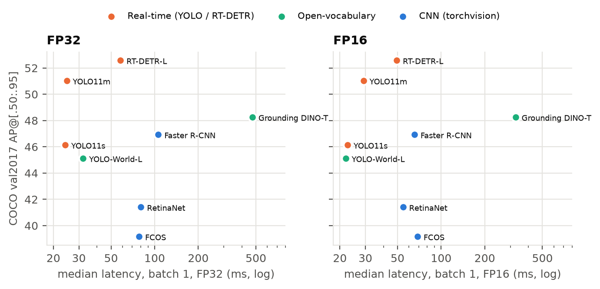
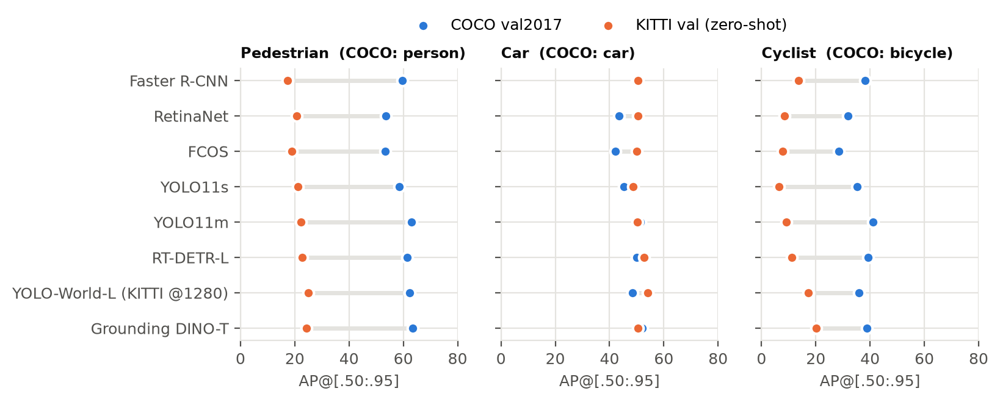
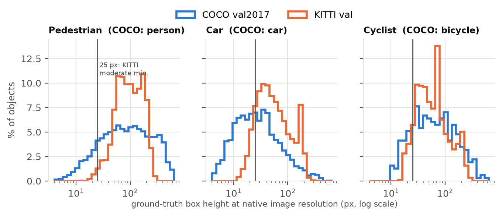
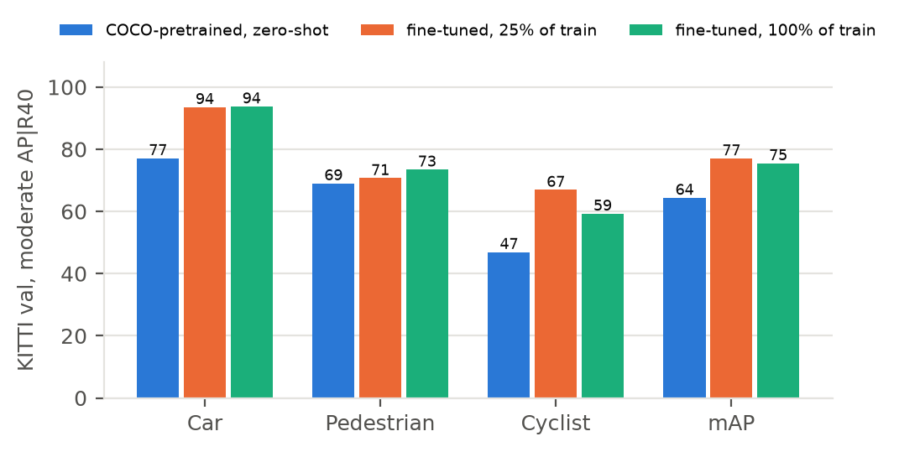
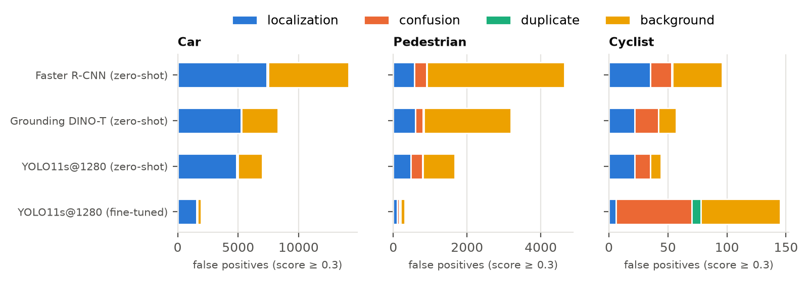
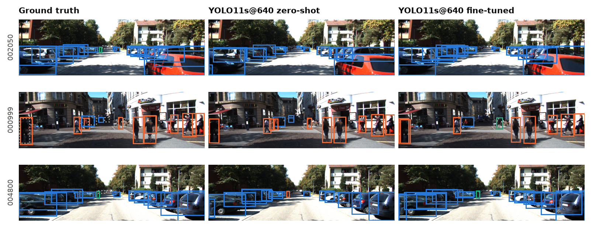

<div class="abstract">

We evaluate eight COCO-trained 2D detector configurations from six families — Faster R-CNN, RetinaNet, FCOS, YOLO11 (s, m),
RT-DETR and the open-vocabulary YOLO-World and Grounding DINO — under one protocol on COCO val2017 and, without retraining, on the KITTI
driving benchmark, and then fine-tune a small detector on KITTI. All eight models reproduce their published COCO AP within 0.9 points.
Transferred to KITTI, Car accuracy is essentially preserved (COCO-style AP 49.9 → 50.4 for Faster R-CNN) while Pedestrian and Cyclist
lose about two-thirds of their AP, through a mix of taxonomy mismatch, annotation convention and resize-induced shrinkage. The largest
zero-shot levers are not architectural: keeping KITTI's wide frames at 1280 px adds 7.6 Moderate mAP to YOLO11m, and the COCO→KITTI
Cyclist mapping alone swings Cyclist AP by up to 67 points. The two open-vocabulary detectors, sixth and third on COCO, are the best
zero-shot KITTI detectors (70.9 and 70.5 Moderate mAP), yet prompting them with KITTI's own class names is 25–31 points worse than using
COCO names and a geometric mapping. Fine-tuning YOLO11s on KITTI at 1280 px lifts it from 64.4 to 75.5 Moderate mAP — and to 77.0 with
only a quarter of the labels — mostly by fixing localisation at KITTI's 0.7 Car IoU. An
adversarial review of the evaluation code found and fixed an ignore-rule bug before any result was reported.

</div>

# 1. Introduction

Detectors are trained and ranked on COCO [1], yet an autonomous vehicle sees a different world: wide 1242×375 frames, objects at
distance, heavy occlusion, and a label taxonomy (Car / Pedestrian / Cyclist) that does not match COCO's 80 classes. This report asks
whether published COCO accuracy predicts behaviour on a driving benchmark, KITTI [2], when the detector is **not retrained** (dataset shift is a known failure mode of driving perception [24]), and
what it takes to close the gap. We evaluate **eight model configurations from six detector families** — two-stage CNN, one-stage
anchor-based, one-stage anchor-free, real-time YOLO, real-time DETR and open-vocabulary detectors — under one shared protocol, and
answer four questions:

* **RQ1 (reproduction).** Do our numbers match the published COCO results, and how do the families trade accuracy for speed?
* **RQ2 (cross-dataset generalization).** How much accuracy survives the COCO → KITTI shift, and which classes and object scales degrade most?
* **RQ3 (closed-set vs. open-vocabulary).** Can a text-prompted detector use KITTI's own class names instead of a hand-made mapping?
* **RQ4 (fine-tuning).** How much of the gap does a short fine-tune on KITTI train recover?

Before any result was recorded, the evaluation code was put through an adversarial review (Section 3.4) that found and fixed a
KITTI ignore-rule bug that would have inflated every KITTI number.

# 2. Models and datasets

## 2.1 Detectors

All checkpoints are the official COCO-trained weights (Table 1 lists the reproduced and published accuracy). **Faster R-CNN** [3]
with FPN [4] is the two-stage reference; we use torchvision's improved "v2" recipe [5]. **RetinaNet** [6] (v2 weights trained with
the ATSS recipe [7]) and **FCOS** [8] represent one-stage dense detectors, anchor-based and anchor-free. **YOLO11** [9], [10]
(s and m) is the current Ultralytics real-time CNN, a descendant of YOLO [11]. **RT-DETR-L** [12] is a real-time member of the
DETR family [13], [14]: set prediction with no NMS. **YOLO-World-L v2** [15] and **Grounding DINO-T** [16] (Hugging Face port [25]) are open-vocabulary
detectors that score boxes against text prompts; neither was trained on COCO annotations, so their COCO numbers are
"zero-shot", with the caveat that their grounding data (GoldG) shares images with COCO's sources [15], [16].

## 2.2 Datasets, splits and taxonomy mapping

**COCO val2017** [1] (5,000 images, 80 classes) is the in-domain test. **KITTI 2D object** [2] has 7,481 labelled images; we use the
standard split of Chen et al. [17] (3,712 train / 3,769 val, no shared sequences; lists from OpenPCDet [18]). KITTI val is used only
for evaluation and is never seen during fine-tuning or model selection. Following the official benchmark [19] we score
**Car, Pedestrian and Cyclist**, and reproduce the devkit's ignore rules: `DontCare` regions absorb any detection that falls inside them
(intersection over detection area); `Van` (for Car) and `Person_sitting` (for Pedestrian) are *neighbour classes* that absorb at most
one detection matched by IoU; `Truck`, `Tram` and `Misc` are not evaluated, so a Car detection on a truck is a false positive.

| KITTI class | Source in a COCO-vocabulary detector | Mismatch |
|:---|:---|:---|
| Car | `car` | 1:1. COCO has no "van"; KITTI vans are ignore regions for Car. |
| Pedestrian | `person` that is not riding | COCO `person` also covers riders and sitting people. |
| Cyclist | `person` + `bicycle` fused into one box | COCO boxes the rider and the bike separately; a KITTI Cyclist box encloses both. |
| *(dropped)* | the other 77 COCO classes | `truck`, `bus`, `train` have no evaluated KITTI counterpart. |

<p class="tcap">Table 2. COCO → KITTI taxonomy mapping (src/det_eval/mapping.py).</p>

The Cyclist mapping is the real taxonomy problem. **direct** maps every `bicycle` box to Cyclist — the box covers only the bike and
riders become Pedestrian false positives. **fused** (default) pairs a person with a bicycle when they overlap horizontally by ≥50% of
the narrower box, the person's top is above the bike's, the person's feet lie in the lower half of the bike's vertical extent, and the
person is 0.8–3× the bike's height. The pair becomes one Cyclist with the union box and score s<sub>person</sub>·s<sub>bike</sub>,
the person stays a Pedestrian candidate with score s<sub>person</sub>·(1−s<sub>bike</sub>) (a soft re-label that needs no
threshold), and unpaired bikes (parked) are dropped. **fused-loose** omits the feet/height tests. The rules were fixed from synthetic
cases before any full KITTI evaluation and are reported side by side rather than tuned on val.

# 3. Experimental setup

## 3.1 Hardware and software

NVIDIA GeForce RTX 5060 Laptop GPU (Blackwell, 8 GB, **45 W power limit**), Windows 11, Python 3.12, PyTorch 2.11.0 + CUDA 12.8,
torchvision 0.26.0 [20], Ultralytics 8.4.197, Transformers 5.22.1, pycocotools 2.0 [21]. Every raw-prediction file stores its full
environment, detector configuration and command line.

## 3.2 Inference protocol

The same protocol is applied to every model so that differences come from the models, not the settings:

* score threshold **0.001**; up to 300 raw detections are kept and the COCO budget of **100 detections per image** is applied *after*
  mapping to the evaluation taxonomy (otherwise 80-class models would waste slots on classes KITTI ignores);
* each model's native NMS IoU (YOLO 0.7, Faster R-CNN / RetinaNet 0.5, FCOS 0.6) with **multi-label** NMS; none for the DETRs;
* **batch 1, FP32**, images decoded outside the timed region; latency = median per-image time of the full `predict()` call
  (pre-processing, network, NMS, post-processing) with CUDA synchronisation;
* native input pipelines: torchvision and Grounding DINO resize the short side to 800 px (long side ≤ 1333); YOLO models letterbox
  the long side to 640 (or 1280) with stride padding; RT-DETR stretches to a 640×640 square.

## 3.3 Metrics

**COCO-style** (pycocotools): AP@[.50:.95], AP50, AP75, AP for small (<32² px), medium and large objects, AR@100 and per-class AP.
On KITTI the same metrics are computed for the three classes with every labelled object counted. **KITTI-style**: AP with 40
recall points (AP|R40, the official metric since 2019 [22]) at class-specific IoU (Car 0.7, Pedestrian/Cyclist 0.5) for the
Easy / Moderate / Hard levels (min. height 40/25/25 px, max. occlusion 0/1/2, max. truncation 15/30/50 %); objects outside a level
become ignore regions and detections shorter than its minimum height are discarded.

## 3.4 Verification of the evaluation code

Before the final runs, a 47-agent adversarial review of the evaluation code (five reviewers, two independent refuters per finding)
upheld 19 of 21 findings. The key one: our first version treated Van / Person_sitting / difficulty-filtered objects as COCO "crowd"
regions, which match by intersection-over-detection and absorb *unlimited* detections, whereas the devkit matches them by IoU, one
detection each — silently forgiving duplicate boxes and inflating KITTI AP. A `COCOeval` subclass now honours a separate `kitti_ignore`
flag; 18 regression tests in `tests/` encode the reviewers' reproduction cases.

## 3.5 Commands

```bash
uv sync && bash scripts/download_data.sh && uv run python scripts/prepare_kitti.py && uv run pytest tests
uv run python scripts/run_inference.py --model yolo11m --dataset kitti --imgsz 1280       # one run (raw detections)
uv run python scripts/finetune_yolo.py --model yolo11s.pt --imgsz 1280 --epochs 20 --batch 4 --fraction 1.0
uv run python scripts/evaluate.py && uv run python scripts/benchmark_speed.py && uv run python scripts/make_figures.py
```

`scripts/run_reduced.sh`, `run_finetune_short.sh` and `run_overnight.sh` contain the exact run list. Every executed command, with its start time, wall-clock time, throughput and peak memory, is in `logs/command_log.txt`; per-run
configurations are in `results/metrics/*.json` (`meta.detector`, `meta.environment`, `meta.command`).

# 4. Results

## 4.1 COCO val2017 (in-domain)

<!--TABLE:coco-->
<p class="tcap">Table 1. COCO val2017, 5,000 images. Publ. AP from the official torchvision / Ultralytics documentation and the papers
(*zero-shot numbers from [15], [16]). FP32 / FP16 ms: median batch-1 latency of the full predict() call over 100 COCO images after a
warm-up pass (scripts/benchmark_speed.py); Mem: peak allocated GPU memory at FP32.</p>

**RQ1.** Every model reproduces its published COCO AP to within 0.9 points (Table 1); torchvision models land within ±0.2 and
the open-vocabulary models within 0.1 of their papers. The small, one-directional gap for the Ultralytics models (−0.4 to −0.9) is
explained by our protocol: we cap at 100 detections per image and run batch-1 letterboxed inference, whereas the Ultralytics
validator keeps 300 detections and uses rectangular batches. RT-DETR-L is the most accurate model (52.6 AP, best on every scale),
YOLO11m is 1.6 AP behind at half the latency, and the 2019–2020-era dense detectors (RetinaNet, FCOS) trail by 11–13 AP. On this
power-limited laptop GPU the YOLO models (24–32 ms) are 2.4–4.4× and RT-DETR-L (58 ms) 1.3–1.8× faster than the torchvision R50-FPN
detectors (78–106 ms), while Grounding DINO costs 0.47 s per image, 19× YOLO11m (Figure 1). Absolute latencies are eager-PyTorch numbers
including Python pre/post-processing and are not comparable to the TensorRT figures in the papers.

<figure><figcaption>Figure 1. Speed–accuracy on COCO val2017, batch 1, FP32 (left) and FP16 (right), 45 W laptop GPU.</figcaption></figure>

## 4.2 KITTI val without retraining (cross-domain)

<!--TABLE:kitti-->
<p class="tcap">Table 3. KITTI val (3,769 images), three classes, default (fused) mapping. Columns 3–8: COCO-style AP@[.50:.95]; columns
9–11: Moderate AP|R40 per class; columns 12–14: mean AP|R40 per difficulty. † RT-DETR stretches the frame to a square. Bold: best zero-shot value.
The last three rows are fine-tuned models (Section 5.6).</p>

Without retraining, every detector loses 29–47% of its COCO-style AP on KITTI (Table 3), but the loss is very unevenly
distributed across classes and scales (Section 5.1). The best zero-shot results come from the open-vocabulary models (YOLO-World-L 70.9, Grounding DINO-T 70.5 Moderate mAP); the best
closed-set ones are YOLO11m and RT-DETR-L at 1280 px (65.3 each). All remain below a fine-tuned YOLO11s (75.5–77.0; Section 5.6).

# 5. Technical analyses

## 5.1 Cross-dataset generalization: which classes and scales degrade?

<figure><figcaption>Figure 2. Per-class AP@[.50:.95] on COCO val2017
(blue) and zero-shot on KITTI val (orange). Ultralytics models use 640 px on both datasets; YOLO-World uses 1280 px on KITTI.</figcaption></figure>

**Car transfers; people do not.** COCO-trained detectors find KITTI cars about as well as COCO cars: Faster R-CNN scores 49.9 AP on
COCO `car` and 50.4 on KITTI Car; YOLO11s 45.4 vs. 48.7 (Figure 2). Car AP50 on KITTI is 82–89 for every model. Pedestrian AP,
in contrast, falls from 53–63 on COCO `person` to 17–25 on KITTI, and Cyclist from 28–41 (`bicycle`) to 7–20. Three effects
compound for people: (i) **taxonomy** — COCO `person` includes riders and sitting people, so correct COCO behaviour produces KITTI false
positives (`confusion:Cyclist` is a major Pedestrian error class in Section 6); (ii) **annotation convention** — KITTI pedestrian
boxes are tight, labelled down to small sizes, and heavily occluded instances count, so many detections that would be correct on COCO
fail the stricter IoU thresholds (Pedestrian AP50 is 42–61 while Car AP50 is 82–89); (iii) **scale after resizing** — at 640 px the
1242×375 frame is downsampled ×0.52, turning a median 96-px pedestrian into a 50-px one and the tail into sub-20-px objects.

**Scale is a resizing artefact, not a property of the data.** At native resolution KITTI objects are not smaller than COCO's
(median height: Car 50 px vs. 26 px in COCO, Pedestrian 96 px vs. 83 px; Figure 3). They become small only when the frame is shrunk to
fit a 640-px input. Running the same YOLO11m weights at 1280 px — no retraining — raises KITTI AP from 27.2 to 29.8, small-object AP
from 16.4 to 22.4, and Moderate mAP from 57.7 to 65.3; Cyclist Moderate AP jumps from 35.0 to 50.9 and Pedestrian from 64.9 to 70.5,
while Car changes little (73.2 → 74.4) because cars are large enough at either size. The same holds for YOLO11s (52.1 → 64.4) and
RT-DETR-L (60.7 → 65.3; Figure 7 in the repository, `figures/fig_resolution_ablation.png`). On COCO the usual degradation runs from large to
small objects (APl 67 → APs 33 for YOLO11m); on KITTI APl is only 36–40 for every model, because "large" KITTI objects are mostly near,
truncated cars at the image border, whose boxes COCO models localise poorly at IoU ≥ 0.75.

<figure><figcaption>Figure 3. Box heights at native resolution for the
three shared classes. KITTI objects are not smaller than COCO's in pixels; downsampling the 1242-px-wide frame to 640 px halves them.</figcaption></figure>

## 5.2 Architecture comparison: two-stage vs. one-stage vs. DETR

At the same nominal 640-px setting, the transformer RT-DETR-L generalises best among the closed-set models: 28.9 KITTI AP and 60.7
Moderate mAP versus 27.2 / 57.7 for the CNN YOLO11m, with the best Car result among the 640-px runs (77.0 Moderate) and much higher recall than
YOLO11s on sub-25-px objects (Car 79% vs. 64%). Read naively, this says set prediction and global attention transfer better. The input
pipelines say otherwise: Ultralytics stretches RT-DETR's input to a square, so at "640" a KITTI frame is *upsampled* vertically
(375 → 640 px) and the model sees 3.3× more pixels than YOLO11m's 640×194 letterbox. Once both receive enough pixels the gap closes:
at 1280 px YOLO11m and RT-DETR-L tie at 65.3 Moderate mAP, and YOLO11s is only one point behind (64.4) — on KITTI the input geometry
matters more than the detector family. Among the R50-FPN detectors at their native ~1333×402 input, the ranking mirrors COCO: two-stage
Faster R-CNN (58.8) > anchor-based RetinaNet (56.1) > anchor-free FCOS (53.7). Faster R-CNN is the best closed-set zero-shot Cyclist
detector at that input (49.9) but the worst on Pedestrian (51.1), where its many confident person boxes are penalised by the mapping
(Section 5.3); its region-based box refinement does not help at KITTI's 0.7 Car IoU (19% of its matched cars fall below 0.7, as for the
single-stage models). All closed-set families converge to AP75 ≈ 22–27 on KITTI despite spanning 39.2–52.6 AP on COCO: the shared COCO
training signal, not the architecture, sets the zero-shot ceiling.

## 5.3 Taxonomy mismatch: how much is the Cyclist mapping worth?

<!--TABLE:mapping-->
<p class="tcap">Table 4. Sensitivity of Pedestrian/Cyclist accuracy to the Cyclist mapping (COCO-style AP and Moderate AP|R40).</p>

With the naive **direct** mapping, Cyclist Moderate AP is 0.1–1.0 for every COCO-vocabulary model: a bicycle-only box never reaches
IoU 0.5 with a KITTI box that also contains the rider. Fusing person and bicycle recovers it to 24–68 (strict rule; 20–64 with the loose rule). The **strict** rule (default)
gives the best Cyclist AP for every detector; its duplicate suppression costs Faster R-CNN 11 Pedestrian points but YOLO11 almost
nothing. Swings this large from a few lines of post-processing mean cross-taxonomy numbers are only meaningful together with their mapping.

## 5.4 Closed-set vs. open-vocabulary

<!--TABLE:prompt-->
<p class="tcap">Table 5. Open-vocabulary detectors on KITTI val with different prompt vocabularies (COCO-style AP and Moderate AP|R40).</p>

**Open-vocabulary pre-training generalises best — but not through the prompts.** Queried with the 80 COCO names and *the same
COCO→KITTI mapping as the closed-set models*, both open-vocabulary detectors top the zero-shot ranking: YOLO-World-L reaches 70.9
Moderate mAP (Car 79.7, Pedestrian 71.6, Cyclist 61.5) and Grounding DINO-T 70.5 (Car 73.0, Pedestrian 70.4, Cyclist 68.0, the best
zero-shot Cyclist result). YOLO-World-L beats YOLO11m at the same 1280-px input by 5.6 points although it is 5.9 AP *worse* on COCO.
Their region-text pre-training on Objects365, GoldG and web image-text data [15], [16] covers far more scenes, scales and viewpoints than
COCO alone, and that breadth transfers to the road better than in-domain accuracy. In-domain rank is a poor predictor of out-of-domain rank.

**Prompting with KITTI's own class names makes it worse.** Replacing the COCO vocabulary by KITTI's names drops Pedestrian from 71.6 to
42.6 and Cyclist from 61.5 to 20.5 (Table 5); the descriptive phrase "person riding a bicycle" is worse still (Cyclist 9.8). Car, whose
name is identical in both vocabularies, barely moves (79.7 → 76.2). "Pedestrian" and "cyclist" are rare words in image-text data
compared with "person" and "bicycle", so their text embeddings are poorly grounded, and a phrase describes a relation (person *on*
bicycle) that a region-text matcher scores on the person region alone, so the predicted box misses the bike. The promise of
open-vocabulary detection — "just name the target classes" — did not hold here: the closed-set-style vocabulary plus an explicit
geometric mapping beat every KITTI-native prompt. Grounding DINO-T shows the same pattern more strongly: with KITTI names its Car
result is unchanged (75.6 vs. 73.0) but Pedestrian collapses from 70.4 to 25.7 and Cyclist from 68.0 to 18.4 (39.9 vs. 70.5 Moderate mAP).

## 5.5 Speed–accuracy trade-off

On COCO the FP32 Pareto front on this GPU is YOLO11s (24 ms, 46.1 AP) → YOLO11m (25 ms, 51.0) → RT-DETR-L (58 ms, 52.6); the
torchvision detectors are dominated (78–106 ms for 39–47 AP) and Grounding DINO pays 473 ms for open-vocabulary flexibility. **FP16**
(autocast / half weights, Table 1) speeds up the heavier models by 1.1–1.6× (Faster R-CNN 106 → 65 ms, RT-DETR-L 58 → 49, YOLO-World-L
32 → 22, Grounding DINO 473 → 326) and cuts peak memory by 1–47% (most for RT-DETR-L and YOLO-World), but does not help YOLO11s/m
(23 vs. 24 ms; YOLO11m is even slower, 29 vs. 25 ms): their batch-1 latency is set by Python-side letterboxing and post-processing,
not by GPU compute. On KITTI, input resolution is the main knob:
1280 px adds 7.6–12.3 Moderate mAP for the YOLO models at little cost (YOLO11s 26 → 23 ms, YOLO11m 26 → 31 ms, still CPU-bound), whereas
RT-DETR-L's square stretch makes 1280 px expensive (61 → 112 ms FP32, 440 MB). Peak memory stays below 0.5 GB for every real-time model
and reaches 2.2 GB for Grounding DINO, so on an 8-GB GPU memory constrains training (YOLO11m at 1280 px did not fit), not inference.

## 5.6 Fine-tuning: zero-shot vs. adapted

<figure><figcaption>Figure 4. YOLO11s at 1280 px: COCO weights zero-shot vs.
20 epochs of fine-tuning on 25% or 100% of KITTI train. KITTI val Moderate AP|R40.</figcaption></figure>

Twenty epochs on KITTI train at 1280 px (1.24 h, 4.6 GB, batch 4) lift YOLO11s from 29.2 to 45.2 COCO-style AP and from 64.4 to 75.5
Moderate mAP (Figure 4). Car gains the most (77.1 → 93.8 Moderate) even though it "transferred" zero-shot: the gain is mostly
localisation — the share of matched cars whose IoU falls below KITTI's 0.7 threshold drops from 18% to 4% (Section 6), and Car AP75
nearly doubles. Cyclist rises from 46.9 to 59.3 because the model now predicts KITTI's rider-plus-bike box directly; Pedestrian gains least
(69.0 → 73.5) and its recall on pedestrians shorter than 25 px actually falls (66% → 3%), while recall on heavily occluded people rises.
**Labels are not the bottleneck:** the same schedule on 25% of the training images (0.38 h) reaches 77.0 Moderate mAP — Car and
Pedestrian within 3 points of the full run and Cyclist higher (66.9 vs. 59.3). With one seed and ~900 validation cyclists this
difference is within run-to-run noise; the robust conclusion is that ~900 labelled frames recover essentially all of the gain (even 5 epochs at 640 px reach 65.8).
**For a fixed deployment budget, a little in-domain fine-tuning is worth more than a larger model, a larger input or a broader
pre-training corpus** — the fine-tuned 9-M-parameter YOLO11s beats both open-vocabulary models by 5–7 points at a fraction of their cost.

# 6. Failure analysis

<!--TABLE:failure-->
<p class="tcap">Table 6. Recall (all detections, class IoU threshold) by ground-truth box height (px) and occlusion level, and share of
matched Car detections (score ≥ 0.3, IoU ≥ 0.5) whose IoU is below 0.7.</p>

<figure><figcaption>Figure 5. False positives at score ≥ 0.3, classified
TIDE-style [23] against the full KITTI label set: localisation (same-class GT with 0.1 ≤ IoU < threshold), confusion (IoU ≥ 0.5 with a GT of
another class), duplicate, background. Detections absorbed by ignore regions are excluded.</figcaption></figure>

**Localisation, not detection, limits Car.** Zero-shot detectors find 84–90% of cars taller than 100 px, yet 16–19% of the cars they
match at IoU 0.5 fall short of 0.7, and localisation is the largest Car false-positive class once ignore regions are excluded (Figure 5).
COCO's box convention for partially visible and truncated vehicles differs from KITTI's, and the strict 0.7 IoU turns that into misses.
Fine-tuning almost removes the problem (4% below 0.7) and raises recall of heavily occluded cars from 35–41% to 84%.

**Small and occluded people are missed; riders are double-counted.** Small-object recall depends on input pixels: YOLO11s recalls 41%
of pedestrians below 25 px at 640 px but 66% at 1280 px, close to Faster R-CNN (75%) and Grounding DINO (72%) at ~1333 px; heavy
occlusion roughly halves zero-shot Pedestrian recall (42–51%). `confusion:Cyclist` (a rider detected as a pedestrian) is a recurring
Pedestrian error, a direct symptom of the taxonomy gap; after fine-tuning, the opposite confusion (pedestrians walking next to bikes called cyclists) becomes a
major Cyclist error alongside background.
Background false positives (poles, signs, shop fronts detected as people) are about 4× more frequent for Faster R-CNN and 3× for
Grounding DINO than for YOLO11s at the same 0.3 operating point, reflecting different score calibration rather than worse ranking.

<figure><figcaption>Figure 6. KITTI val examples (score ≥ 0.3). Blue: Car,
orange: Pedestrian, aqua: Cyclist; grey dotted: ignore regions. Left to right: ground truth, YOLO11s@640 zero-shot, fine-tuned. Zero-shot misses the distant cyclist (row 1) or calls it a pedestrian
(row 3) and misses far, small cars; the fine-tuned model recovers both, but still splits the occluded pedestrian at the left edge of row 2.</figcaption></figure>

# 7. Limitations

All experiments ran on a single 8-GB laptop GPU. Fine-tuning uses one model (YOLO11s) and a single seed per configuration, so
differences of a few points between the 25% and 100% runs are within noise; YOLO11m at 1280 px did not fit in memory for training.
Latency is batch-1 eager PyTorch with Python overhead on a 45-W GPU (each model timed in one contiguous warm block) and should be
read as relative, not absolute. KITTI AP is computed with pycocotools (40-point recall grid, devkit ignore rules reproduced and unit-tested) but was not
cross-checked against the official C++ binary on full predictions. The open-vocabulary models' "zero-shot" COCO results carry the
image-overlap caveat of their grounding data.

# 8. Conclusions

1. **Published COCO accuracy is reproducible** under one uniform protocol (all eight models within 0.9 AP); on COCO the real-time models
   dominate — RT-DETR-L is the most accurate, YOLO11m the best accuracy per millisecond.
2. **COCO accuracy predicts KITTI Car accuracy but not Pedestrian or Cyclist.** Car AP is essentially unchanged across datasets, while
   people lose about two-thirds of their AP to taxonomy, box-convention and resize effects.
3. **The biggest zero-shot levers are the input pipeline and the label mapping, not the architecture:** keeping KITTI at 1280 px adds
   5–12 Moderate mAP (and erases the YOLO/RT-DETR gap), and the Cyclist mapping alone swings Cyclist AP by up to 67 points.
4. **Broad open-vocabulary pre-training transfers better than COCO accuracy, but prompts are not a substitute for a mapping:**
   YOLO-World-L and Grounding DINO-T are the best zero-shot KITTI detectors (70.9 / 70.5 Moderate mAP), yet prompting them with KITTI's
   own class names costs 25–31 Moderate mAP relative to COCO names plus a geometric mapping.
5. **Modest fine-tuning beats everything else:** 20 epochs at 1280 px lift YOLO11s from 64.4 to 75.5 Moderate mAP (77.0 with a quarter
   of the labels), mostly by fixing localisation at KITTI's 0.7 IoU, so a 9-M-parameter model beats every zero-shot detector.
6. **Evaluation code deserves the same scrutiny as models:** an adversarial review caught an ignore-rule bug that would have inflated every
   KITTI number before any result was reported.

# References

<ol class="refs">
<li>T.-Y. Lin et al., "Microsoft COCO: Common Objects in Context," in <i>Proc. ECCV</i>, 2014, pp. 740–755. arXiv:1405.0312.</li>
<li>A. Geiger, P. Lenz, and R. Urtasun, "Are We Ready for Autonomous Driving? The KITTI Vision Benchmark Suite," in <i>Proc. IEEE CVPR</i>, 2012, pp. 3354–3361.</li>
<li>S. Ren, K. He, R. Girshick, and J. Sun, "Faster R-CNN: Towards Real-Time Object Detection with Region Proposal Networks," in <i>Advances in NIPS 28</i>, 2015. arXiv:1506.01497.</li>
<li>T.-Y. Lin et al., "Feature Pyramid Networks for Object Detection," in <i>Proc. IEEE CVPR</i>, 2017. arXiv:1612.03144.</li>
<li>Y. Li et al., "Benchmarking Detection Transfer Learning with Vision Transformers," arXiv:2111.11429, 2021.</li>
<li>T.-Y. Lin, P. Goyal, R. Girshick, K. He, and P. Dollár, "Focal Loss for Dense Object Detection," in <i>Proc. IEEE ICCV</i>, 2017. arXiv:1708.02002.</li>
<li>S. Zhang et al., "Bridging the Gap Between Anchor-Based and Anchor-Free Detection via Adaptive Training Sample Selection," in <i>Proc. IEEE/CVF CVPR</i>, 2020. arXiv:1912.02424.</li>
<li>Z. Tian, C. Shen, H. Chen, and T. He, "FCOS: Fully Convolutional One-Stage Object Detection," in <i>Proc. IEEE/CVF ICCV</i>, 2019. arXiv:1904.01355.</li>
<li>G. Jocher and J. Qiu, "Ultralytics YOLO11," software v11.0.0, 2024. Docs: https://docs.ultralytics.com/models/yolo11/; code: https://github.com/ultralytics/ultralytics.</li>
<li>R. Khanam and M. Hussain, "YOLOv11: An Overview of the Key Architectural Enhancements," arXiv:2410.17725, 2024.</li>
<li>J. Redmon, S. Divvala, R. Girshick, and A. Farhadi, "You Only Look Once: Unified, Real-Time Object Detection," in <i>Proc. IEEE CVPR</i>, 2016. arXiv:1506.02640.</li>
<li>Y. Zhao et al., "DETRs Beat YOLOs on Real-time Object Detection," in <i>Proc. IEEE/CVF CVPR</i>, 2024, pp. 16965–16974. arXiv:2304.08069.</li>
<li>N. Carion et al., "End-to-End Object Detection with Transformers," in <i>Proc. ECCV</i>, 2020. arXiv:2005.12872.</li>
<li>X. Zhu, W. Su, L. Lu, B. Li, X. Wang, and J. Dai, "Deformable DETR: Deformable Transformers for End-to-End Object Detection," in <i>Proc. ICLR</i>, 2021. arXiv:2010.04159.</li>
<li>T. Cheng, L. Song, Y. Ge, W. Liu, X. Wang, and Y. Shan, "YOLO-World: Real-Time Open-Vocabulary Object Detection," in <i>Proc. IEEE/CVF CVPR</i>, 2024. arXiv:2401.17270.</li>
<li>S. Liu et al., "Grounding DINO: Marrying DINO with Grounded Pre-Training for Open-Set Object Detection," in <i>Proc. ECCV</i>, 2024. arXiv:2303.05499.</li>
<li>X. Chen et al., "3D Object Proposals for Accurate Object Class Detection," in <i>Advances in NIPS 28</i>, 2015.</li>
<li>OpenPCDet Development Team, "OpenPCDet: An Open-source Toolbox for 3D Object Detection from Point Clouds," 2020. https://github.com/open-mmlab/OpenPCDet.</li>
<li>A. Geiger, P. Lenz, and R. Urtasun, "KITTI 2D Object Detection Benchmark and devkit," https://www.cvlibs.net/datasets/kitti/eval_object.php?obj_benchmark=2d (accessed Nov. 2026).</li>
<li>TorchVision maintainers and contributors, "TorchVision: PyTorch's Computer Vision Library," 2016; detection model docs: https://docs.pytorch.org/vision/stable/models.html.</li>
<li>COCO Consortium, "COCO API (pycocotools)," https://github.com/cocodataset/cocoapi; "Detection evaluation," https://cocodataset.org/#detection-eval.</li>
<li>A. Simonelli, S. Rota Bulò, L. Porzi, M. López-Antequera, and P. Kontschieder, "Disentangling Monocular 3D Object Detection," in <i>Proc. IEEE/CVF ICCV</i>, 2019. arXiv:1905.12365.</li>
<li>D. Bolya, S. Foley, J. Hays, and J. Hoffman, "TIDE: A General Toolbox for Identifying Object Detection Errors," in <i>Proc. ECCV</i>, 2020. arXiv:2008.08115.</li>
<li>Y. Wang et al., "Train in Germany, Test in the USA: Making 3D Object Detectors Generalize," in <i>Proc. IEEE/CVF CVPR</i>, 2020. arXiv:2005.08139.</li>
<li>Hugging Face, "Grounding DINO — Transformers documentation," https://huggingface.co/docs/transformers/model_doc/grounding-dino; checkpoint IDEA-Research/grounding-dino-tiny.</li>
</ol>
